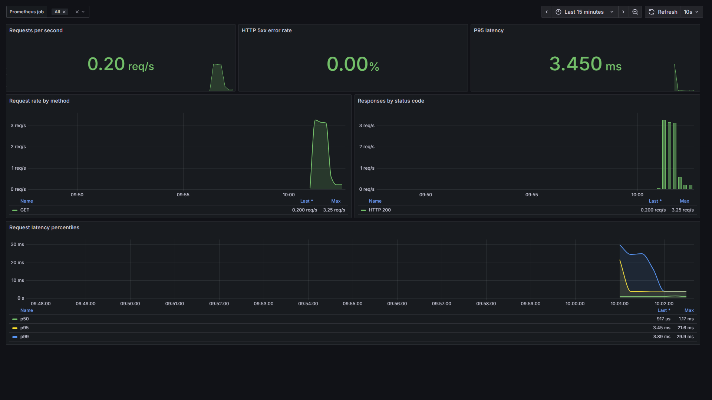

# Roteiro de apresentação — Order

Este roteiro cobre a parte do Order na apresentação da N2 de 10/11/2026. A
fonte de verdade do ambiente compartilhado é o kit `eks/` do repositório
`api-gateway`. Minikube e a stack local de observabilidade continuam úteis para
desenvolvimento, mas não substituem a demonstração no Amazon EKS.

## 1. Preparação do ambiente compartilhado

O responsável pelo cluster executa, a partir do repositório `api-gateway`:

```bash
bash eks/create-cluster.sh
bash eks/apply.sh
kubectl get pods -A -w
```

Antes da demonstração, confirme:

```bash
kubectl get deployment order rabbitmq promotion-consumer support
kubectl get statefulset order-sqlserver
kubectl get service order order-sqlserver rabbitmq shopping-cart product-api support
kubectl get pods -l app.kubernetes.io/name=order
kubectl rollout status deployment/order
```

O kit EKS reduz algumas réplicas para caber nos dois nodes `t3.large` do
Learner Lab. O chart do Order mantém três réplicas como padrão para a execução
isolada, mas o balanceamento da solução compartilhada deve ser demonstrado nos
serviços que o kit mantém replicados, principalmente Gateway e Promotion.

O único acesso externo é o Ingress do API Gateway. Order, `/internal` e
`/metrics` permanecem internos ao cluster.

## 2. Fluxo funcional do pedido

Obtenha o endereço do Ingress e use um access token real do Authorization:

```bash
ELB=$(kubectl -n ingress-nginx get svc ingress-nginx-controller -o jsonpath='{.status.loadBalancer.ingress[0].hostname}')
TOKEN='<access-token-do-authorization>'
```

Prepare Product, Cart e Promotion conforme o roteiro integrado do grupo. O
Promotion perde os dados sempre que o Pod com `emptyDir` é recriado, portanto
semeie os cupons antes do teste:

```bash
kubectl exec deploy/promotion -c promotion -- php artisan db:seed --force
curl -fsS -H "Authorization: Bearer $TOKEN" "http://$ELB/api/cart?coupon=BEMVINDO10"
```

Crie o pedido pelo Gateway. Troque a chave de idempotência a cada pedido novo:

```bash
IDEMPOTENCY_KEY="n2-order-$(date +%s)"

curl -i -X POST "http://$ELB/api/pedidos" \
  -H "Authorization: Bearer $TOKEN" \
  -H "Idempotency-Key: $IDEMPOTENCY_KEY" \
  -H "Content-Type: application/json" \
  -d '{
    "endereco_entrega": {
      "rua": "Rua da Demonstracao",
      "numero": "100",
      "complemento": "Laboratorio",
      "bairro": "Centro",
      "cidade": "Curitiba",
      "estado": "PR",
      "cep": "80000000",
      "pais": "BR"
    }
  }'
```

O resultado esperado é `201 Created`. Repita a mesma chamada com a mesma
`Idempotency-Key`: deve retornar o mesmo pedido sem novo decremento de estoque,
novo evento ou novo e-mail.

## 3. O que mostrar do Order

Explique a sequência abaixo enquanto o pedido é criado:

1. O Gateway centraliza a entrada pública e encaminha o Bearer token e o
   `X-Correlation-ID`.
2. O Order valida localmente o JWT RS256, lê o snapshot autenticado do Cart e
   reserva estoque no Product.
3. Pedido, idempotência, `OrderConfirmed` e `OrderCreated` são persistidos no
   SQL Server. Os dois eventos entram no outbox na mesma transação do pedido.
4. O worker do outbox publica mensagens persistentes na exchange durável
   `ganjj.orders`, usando publisher confirms.
5. Promotion consome `order.confirmed`; Support consome `order.created` e envia
   o e-mail ao Mailpit.

Observe o processamento sem expor segredos:

```bash
kubectl exec deploy/rabbitmq -- rabbitmqctl list_queues name messages consumers
kubectl logs deployment/order --since=5m
kubectl logs deployment/promotion-consumer --since=5m
kubectl logs deployment/support --since=5m
```

Para visualizar o e-mail, encaminhe temporariamente o Mailpit e abra
`http://localhost:8025`:

```bash
kubectl port-forward service/mailpit 8025:8025
```

O `port-forward` é somente uma ferramenta de inspeção. O pedido continua
entrando pelo Ingress do Gateway.

## 4. Limitação conhecida do cupom

O Cart calcula `BEMVINDO10` quando recebe o cupom por query string, mas ainda não
persiste uma cotação versionada e autoritativa que o Order possa consumir. Por
isso, o evento real do Order publica `coupon_code: null`; o Promotion registra o
resultado idempotente `no_coupon` e envia o ack sem incrementar `usage_count`.

Não apresente uma mensagem manual com cupom como se ela tivesse sido produzida
pelo Order. Se o grupo demonstrar o incremento com uma publicação AMQP manual,
explique que ela comprova separadamente o contrato e o consumidor do Promotion.
A integração completa do cupom depende da decisão conjunta sobre cotação e
consumo versionados no Cart.

## 5. Pontos técnicos para defender

- ASP.NET Core e SQL Server atendem à diversidade de linguagem e banco.
- O Gateway é a única entrada externa; o Order não possui Ingress próprio.
- O padrão outbox evita perder eventos entre o commit no SQL Server e a
  publicação no RabbitMQ.
- A entrega é pelo menos uma vez. Promotion e Support deduplicam usando IDs
  estáveis do pedido/evento.
- A reserva de estoque usa operações idempotentes e compensação quando uma
  etapa posterior falha.
- Uma indisponibilidade temporária do RabbitMQ não desfaz o pedido: o evento
  permanece pendente no outbox e é tentado novamente.
- `/health`, `/health/ready`, `/instance` e `/metrics` permitem operação e
  observabilidade sem publicar métricas no Ingress.

## 6. Evidências já disponíveis

- O fluxo Authorization + Gateway + Order + SQL Server + Support + Mailpit foi
  validado em 25/10/2026.
- O fluxo Order + SQL Server + RabbitMQ + Support + Mailpit, com o fallback HTTP
  indisponível, foi validado em 29/10/2026.
- Publisher e consumer do `OrderConfirmed` possuem testes com RabbitMQ e bancos
  reais separadamente. A execução conjunta no novo cluster EKS ainda precisa ser
  registrada.

Referências:

- `support/docs/evidence/2026-10-25/order-support.json`;
- `support/docs/evidence/2026-10-28/order-created.json`;
- `promotion/docs/evidencias/eks-2026-10-27.md`.

## 7. Desenvolvimento local e observabilidade extra

Para validar somente o Order no Minikube:

```powershell
./scripts/Start-Kubernetes.ps1
./scripts/Test-Kubernetes.ps1
```

O smoke test comprova réplicas, DNS interno, readiness, métricas e `/instance`.
Para executar o Order sem a infraestrutura compartilhada, use
`-DisableRabbitMqPublisher`; os eventos continuam no outbox até o publisher ser
habilitado.

Para abrir o dashboard local do Order:

```powershell
kubectl port-forward service/order 3004:8080
docker compose -f observability/docker-compose.yml up -d
```

Abra `http://localhost:3000/d/ganjj-order` e mostre requisições por segundo,
status HTTP e latências p50, p95 e p99. Prometheus e Grafana são evidências
extras; o roteiro principal da N2 deve permanecer no EKS.



Ao terminar a apresentação, o responsável pelo cluster deve remover primeiro o
Ingress Controller e depois o cluster, conforme `api-gateway/eks/README.md`,
para não manter ELB, EC2 ou control plane consumindo crédito do Learner Lab.
