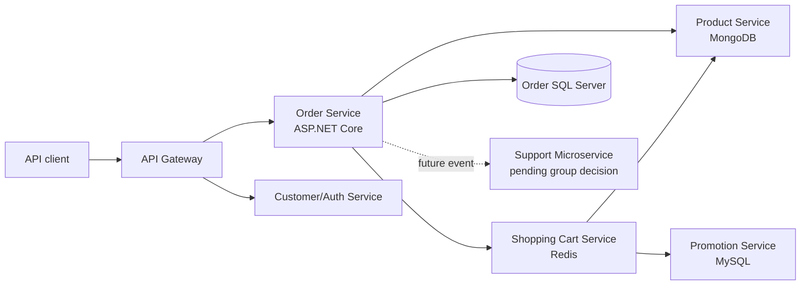
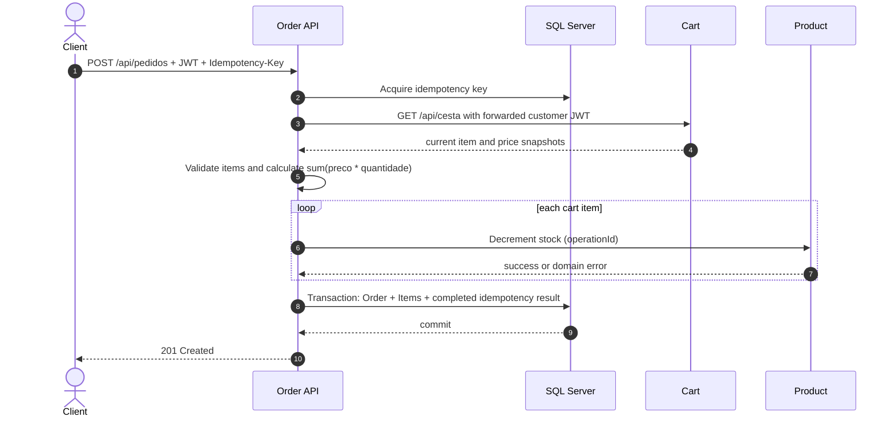
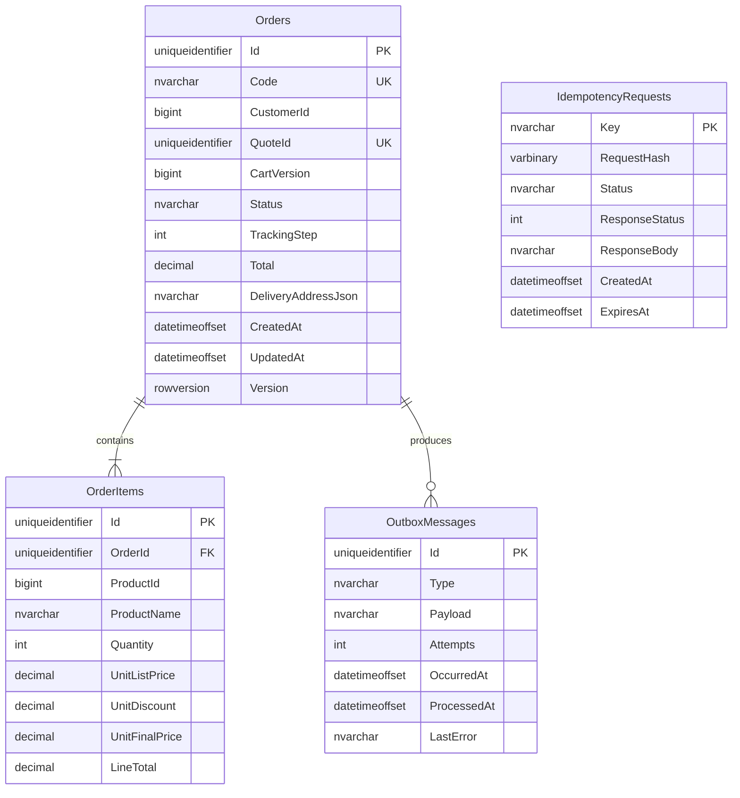
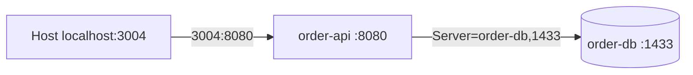

# SDD - GANJJ Order Service

Status: Draft for technical review  
Target runtime: .NET 10 / ASP.NET Core  
Database: Microsoft SQL Server  
Last updated: 2026-08-22

## 1. Architecture objectives

The design prioritizes the course evaluation criteria and a clear demonstration
of cloud-native practices:

- one independently deployable process;
- database per service;
- REST communication with explicit contracts;
- containerized application and database;
- externalized configuration;
- reproducible and versioned images;
- failure handling across service boundaries;
- automated tests written with TDD;
- portability from local Docker to a future AWS/Kubernetes runtime.

The design intentionally avoids production-scale complexity that does not improve
the academic demonstration.

## 2. Architecture principles

1. **Order owns order data.** No other service reads the SQL Server schema.
2. **Snapshots over cross-database joins.** Order stores the historical customer,
   delivery, product, and available price values required to display an order.
3. **Cart is the server-side price source.** The interim implementation consumes
   Cart's existing item snapshots. Order never accepts client prices and never
   implements promotion rules; a promotion-aware quote remains the target.
4. **Product owns stock.** Order coordinates stock changes through the Product API.
5. **Failures are explicit.** A partial checkout triggers compensation and is
   observable; errors are not swallowed.
6. **Idempotency precedes retries.** Unsafe operations are retried only when their
   contract supplies an operation identifier.
7. **The container is stateless.** Persistent state belongs to SQL Server.
8. **Configuration is environment-specific.** The image is identical in local,
   test, and cloud environments.

## 3. Technology choices

| Concern | Choice | Reason |
| --- | --- | --- |
| Runtime | .NET 10 LTS | Current LTS installed in the development environment |
| HTTP API | ASP.NET Core Controllers | Clear validation, authorization, and OpenAPI behavior |
| Persistence | Entity Framework Core with SQL Server provider | Migrations, transactions, and provider support |
| Database | SQL Server 2022 for local container | Stable course/demo baseline and compatible with managed AWS options |
| Authentication | ASP.NET Core JWT Bearer with `id` and `isAdmin` claims | Compatible with the original GANJJ token contract |
| API description | Built-in ASP.NET Core OpenAPI + Scalar | Generated contract plus interactive API visualization |
| Errors | Problem Details | Consistent machine-readable API errors |
| HTTP dependencies | Typed `HttpClient` clients | Dependency injection, timeout, and resilience policies |
| DTO mapping | Manual mappings and EF Core `Select` projections | Keeps domain/snapshot decisions explicit and avoids an unnecessary mapper dependency |
| Tests | xUnit test projects and container-backed integration tests | Supports Red-Green-Refactor and real SQL semantics |
| Packaging | Multi-stage Docker image | Small runtime image and reproducible build |
| Local orchestration | Docker Compose | Automates the network/container steps taught in class |

Exact NuGet patch versions will be pinned when implementation starts. The design
does not depend on preview packages.

## 4. System context



Only Order connects to the Order SQL Server database. Arrows between services are
HTTP unless a future support-service decision introduces a message broker.

## 5. Repository and solution structure

Planned structure after the implementation phase is authorized:

```text
order/
  src/
    Ganjj.Order.Api/
    Ganjj.Order.Application/
    Ganjj.Order.Domain/
    Ganjj.Order.Infrastructure/
  tests/
    Ganjj.Order.Domain.Tests/
    Ganjj.Order.Application.Tests/
    Ganjj.Order.Api.IntegrationTests/
    Ganjj.Order.ContractTests/
  docs/
  Dockerfile
  docker-compose.yml
  .dockerignore
  Ganjj.Order.sln
```

### `Ganjj.Order.Domain`

- `Order` aggregate and `OrderItem` entity.
- Money and delivery-address value objects.
- Status/tracking-step rules.
- Domain invariants and domain exceptions.
- No references to ASP.NET Core, EF Core, or HTTP clients.

### `Ganjj.Order.Application`

- Use cases: create, get, list mine, list all, update tracking.
- Ports/interfaces for persistence, Cart, Product, clock, and identifier creation.
- DTOs and use-case results.
- Saga orchestration and compensation decisions.
- No direct dependency on concrete infrastructure.

### `Ganjj.Order.Infrastructure`

- EF Core `OrderDbContext`, configurations, and migrations.
- SQL Server repositories and idempotency store.
- Typed Cart and Product HTTP clients.
- Outbox dispatcher for post-commit integration actions.
- Configuration binding and dependency health checks.

### `Ganjj.Order.Api`

- Controllers and request/response models.
- Authentication and authorization policies.
- Problem Details mapping.
- OpenAPI, Scalar UI, health endpoints, correlation ID, and middleware composition.
- No business rule implementation inside controllers.

The split is intentionally limited to four production projects. Additional
framework abstractions or mediator libraries are unnecessary for this scope.

## 6. Public HTTP API

The authoritative proposed contract is `openapi/order-service.v1.yaml`.

ASP.NET Core generates the runtime OpenAPI document. Scalar renders that document
as the interactive API reference. The planned default routes are
`/openapi/v1.json` and `/scalar/v1`; exposure outside development/demo
environments remains configuration-controlled.

Request, application, domain, persistence, and response models are mapped
manually. Read-only EF Core queries should project directly to response DTOs with
`Select`. Mapster is not part of the initial dependency set.

| Method | Route | Authorization | Purpose |
| --- | --- | --- | --- |
| POST | `/api/pedidos` | Customer | Create order from current Cart snapshot |
| GET | `/api/pedidos/meus` | Customer | List authenticated customer's orders |
| GET | `/api/pedidos/{id}` | Owner or admin | Get one order snapshot |
| GET | `/api/pedidos/admin/todos` | Admin | List all orders |
| PUT | `/api/pedidos/{id}/passo` | Admin | Update tracking step |
| GET | `/health/live` | Anonymous | Process liveness |
| GET | `/health/ready` | Anonymous | SQL Server readiness |

The Portuguese public routes preserve the original GANJJ integration shape.
Internal type and member names remain English.

## 7. Checkout sequence



If Product rejects an item or the database transaction fails, Order calls the
restore endpoint for every item already decremented in reverse order.

## 8. Create-order algorithm

1. Validate JWT, delivery address, and `Idempotency-Key`.
2. Calculate a stable hash of the relevant request body and authenticated user.
3. Insert an `InProgress` idempotency record under a unique key.
4. If the key already exists:
   - return the stored success for the same completed request;
   - return conflict for an in-progress request;
   - reject reuse of the key with a different request hash.
5. Request `GET /api/cesta` from Cart with the customer's forwarded Bearer token.
6. Validate item count, product identifiers, quantities, prices, and arithmetic.
   For the interim contract, set list/final unit price to Cart's `preco`, discount
   to zero, and calculate `sum(preco * quantidade)`.
7. For each item, request stock decrement with a stable operation ID.
8. In one SQL transaction:
   - insert Order;
   - insert OrderItems;
   - mark the idempotency record completed with the response snapshot.
9. Return `201 Created` after the SQL transaction commits.

The interim implementation does not clear Cart. A future versioned quote/consume
contract can add a post-commit outbox action without changing the public request.

On a failure before SQL commit:

- restore every confirmed stock decrement;
- remove the idempotency record only after confirmed compensation so a safe retry
  can reuse the key;
- retain a failed record and emit a high-severity log if compensation is not
  confirmed.

## 9. Domain model

### Order aggregate

| Field | Type | Notes |
| --- | --- | --- |
| `Id` | `Guid` | Public durable identifier |
| `Code` | string | Human-readable `#GNJ-...` code, unique |
| `CustomerId` | long | External snapshot identifier, no database FK |
| `CustomerName` | string? | Optional snapshot when supplied by trusted token/service |
| `CustomerEmail` | string? | Optional snapshot for display/notification |
| `QuoteId` | `Guid?` | Reserved for the future Cart quote contract |
| `CartVersion` | long? | Reserved for future safe Cart consumption |
| `Status` | enum/string | `pending`, `shipping`, `completed`, `cancelled`, `failed` |
| `TrackingStep` | integer | Inclusive range 0-5 |
| `Total` | decimal(18,2) | Sum of immutable line totals |
| `DeliveryAddress` | value object | Historical address snapshot |
| `TrackingNumber` | string? | Optional carrier reference |
| `CreatedAt` | UTC timestamp | Server-controlled |
| `UpdatedAt` | UTC timestamp | Server-controlled |
| `Version` | rowversion | Optimistic concurrency token |

### Order item snapshot

| Field | Type | Notes |
| --- | --- | --- |
| `Id` | `Guid` | Internal item identifier |
| `OrderId` | `Guid` | FK inside Order database only |
| `ProductId` | long | External Product identifier, no cross-service FK |
| `ProductName` | string | Immutable snapshot |
| `Size` | string? | Immutable variant snapshot |
| `ImageUrl` | string? | Optional display snapshot |
| `Quantity` | integer | Positive |
| `UnitListPrice` | decimal(18,2) | Interim: Cart `preco`; target: price before discount |
| `UnitDiscount` | decimal(18,2) | Interim: zero; target: discount per unit |
| `UnitFinalPrice` | decimal(18,2) | Interim: Cart `preco`; target: final price per unit |
| `LineTotal` | decimal(18,2) | `UnitFinalPrice * Quantity` |
| `PromotionId` | string? | Optional external promotion reference |
| `PromotionName` | string? | Historical promotion description |

### State mapping

| Tracking step | Status |
| --- | --- |
| 0, 1, 2 | `pending` |
| 3, 4 | `shipping` |
| 5 | `completed` |

An admin may move the step forward or backward to preserve the original behavior.
This can be tightened later without schema change.

## 10. Persistence design



### Constraints and indexes

- Unique `Orders.Code`.
- Filtered unique `Orders.QuoteId` when a future non-null quote ID is present.
- Index `Orders(CustomerId, CreatedAt DESC)` for customer history.
- Index `Orders(CreatedAt DESC)` for administrator listing.
- Check `TrackingStep BETWEEN 0 AND 5`.
- Check monetary values and quantities are non-negative/positive as applicable.
- Unique `IdempotencyRequests.Key`.
- Index pending `OutboxMessages` by `ProcessedAt` and `OccurredAt`.

Delivery address may be stored as owned columns or JSON. The implementation should
prefer owned columns if query/reporting is required; otherwise JSON is acceptable
for the immutable snapshot. The initial migration must make this choice explicit.

## 11. Transactions and consistency

### Strong consistency boundary

One SQL transaction covers:

- Order insert;
- all OrderItem inserts;
- idempotency completion;
- a future outbox insert only when a real post-commit integration action exists.

### Eventual consistency boundary

Stock and cart live outside SQL Server. They cannot participate in the local SQL
transaction. The service therefore uses an orchestrated Saga:

- Product stock decrement is the forward action.
- Product stock restore is the compensating action.
- The current Cart is read but not cleared. Future safe quote consumption becomes
  a post-commit outbox action.

No distributed database transaction or shared schema is introduced.

## 12. Integration clients and resilience

### Cart client

- Typed client with base URL from configuration.
- `GET /api/cesta` timeout budget: 3 seconds by default.
- Forward the authenticated customer's Bearer token; never log it.
- Validate and map the current Portuguese Cart payload at this anti-corruption
  boundary while keeping internal C# names in English.
- Do not call `DELETE /api/cesta` automatically without versioning.

### Product client

- Typed client with base URL from configuration.
- Each decrement and restore includes a stable operation ID.
- Timeout budget: 3 seconds per call by default.
- Retry only when Product confirms operation-level idempotency.
- Restore failures are logged as critical with all recovery identifiers.

### Failure matrix

| Failure | API outcome | Required action |
| --- | --- | --- |
| Cart unavailable/timeout | 503 | No stock or order change |
| Cart empty | 409 | No stock or order change |
| Cart payload invalid | 502/422 | No stock or order change; report contract mismatch |
| Product not found | 409/422 | Compensate prior items |
| Insufficient stock | 409 | Compensate prior items |
| SQL transaction fails | 503/500 | Compensate all decremented items |
| Compensation fails | 500 + critical operational state | Preserve failed idempotency/recovery data |
| Duplicate idempotency key | Original result or 409 | Never repeat side effects blindly |

## 13. Authentication and authorization

- Accept `Authorization: Bearer <token>` as the primary mechanism.
- Cookie `accessToken` compatibility may be retained for the original GANJJ flow.
- Validate signature and expiration locally using the Auth signing configuration.
- Read the stable customer identifier from the case-sensitive `id` claim.
- Map `isAdmin == true` to an `Admin` authorization policy.
- Do not require issuer/audience until Auth emits and freezes those claims.
- The create request never accepts `customerId` or `isAdmin` from JSON.
- Detail queries enforce owner-or-admin authorization after loading the order.
- Health endpoints are anonymous and disclose no credentials.
- Internal service credentials are read from secret-backed configuration.

The `id`/`isAdmin` shape is accepted for the initial implementation. A real
signed example and signing configuration are still required for integration.

## 14. Error contract

Errors use `application/problem+json` and include:

- `type` - stable problem URI or identifier;
- `title` - concise category;
- `status` - HTTP status;
- `detail` - safe human-readable explanation;
- `instance` - request path;
- `traceId` - correlation identifier;
- optional domain extensions such as `productId` and `availableStock`.

Internal exception types are never returned to clients.

## 15. Observability

### Logs

- Structured logs to stdout/stderr for container collection.
- Correlation ID accepted from `X-Correlation-ID` or generated at entry.
- Log dependency, duration, result category, order ID, optional quote ID, and
  operation ID.
- Do not log JWTs, connection strings, passwords, or full personal addresses.

### Metrics/traces

The base design leaves an OpenTelemetry-compatible extension point for:

- checkout duration;
- order creation success/failure counts;
- dependency latency and failure counts;
- compensation attempt/failure counts;
- pending outbox message count.

Console/CloudWatch logging is sufficient for the first course milestone;
OpenTelemetry export is a later cloud milestone.

### Health endpoints

- `/health/live`: process can respond; no dependency checks.
- `/health/ready`: verifies SQL Server connectivity with a lightweight check.
- External Product/Cart outages should not make every API replica unready unless
  the final orchestrator policy explicitly requires it.

## 16. Docker design

### Image build

The planned Dockerfile is multi-stage:

1. `mcr.microsoft.com/dotnet/sdk:10.0` restores, builds, tests as appropriate, and
   publishes the API artifact.
2. `mcr.microsoft.com/dotnet/aspnet:10.0` contains only runtime artifacts.
3. Runtime listens on container port `8080`.
4. Runtime uses a non-root user.
5. Image receives explicit version/commit labels.

Example tag policy:

```text
backendcloud/order-service:1.0.0
backendcloud/order-service:sha-<short-commit>
```

Deployments use immutable tags. `latest` may be published for convenience but is
not the source of truth.

### Local containers



Compose will define:

- `order-api` built from this repository;
- `order-db` using `mcr.microsoft.com/mssql/server:2022-latest`;
- a named SQL Server data volume;
- a dedicated Docker network;
- database health check and API dependency condition;
- environment variables without committed secret values.

Inside the API container, the database hostname is `order-db`, never `localhost`.

## 17. Registry, AWS, and Kubernetes portability

The professor's material establishes the path:

```text
source -> artifact -> Docker image -> registry -> Kubernetes
```

The first registry target may be Docker Hub to match the laboratory. AWS ECR can
replace it without rebuilding application code.

The final runtime remains an open deployment decision:

- ECS/Fargate: direct managed container runtime;
- EKS: closest match to the course's stated Kubernetes progression;
- EC2 + Docker Compose: simplest and lowest-concept deployment, but less managed.

The service is prepared for all three by:

- listening on a configurable port;
- storing no local state;
- using DNS service names from configuration;
- exposing health endpoints;
- handling termination gracefully;
- keeping secrets outside the image;
- separating migrations from ordinary request handling.

Kubernetes manifests and AWS infrastructure are deliberately deferred until the
group/course confirms the target.

## 18. Database migrations and startup

- EF Core migrations are versioned in source control.
- Production/cloud startup does not silently apply schema changes from every API
  replica.
- Local Compose may run a documented one-shot migration command.
- Cloud deployment uses a one-shot migration task/job before replacing the API.
- Seed data is limited to optional demonstration fixtures; no old-data migration
  exists.

## 19. Configuration inventory

Proposed environment variable names:

| Variable | Required | Purpose |
| --- | --- | --- |
| `ASPNETCORE_ENVIRONMENT` | Yes | Runtime environment |
| `ASPNETCORE_HTTP_PORTS` | No | Container port, default 8080 |
| `ConnectionStrings__OrderDatabase` | Yes | SQL Server connection |
| `Authentication__Issuer` | No initially | Enable only after Auth emits `iss` |
| `Authentication__Audience` | No initially | Enable only after Auth emits `aud` |
| `Authentication__SigningKey` | Yes for shared-key mode | JWT validation key |
| `Services__Cart__BaseUrl` | Yes | Cart URL |
| `Services__Product__BaseUrl` | Yes | Product URL |
| `Services__InternalSecret` | Yes initially | Internal HTTP authentication |
| `Resilience__HttpTimeoutSeconds` | No | Dependency timeout budget |
| `Outbox__PollIntervalSeconds` | No/future | Outbox dispatch interval when enabled |

Secrets are represented in `.env.example` only by placeholders.

## 20. CI quality gates

Planned GitHub Actions pipeline:

1. restore with locked dependency metadata;
2. build in Release mode with warnings treated according to project policy;
3. run unit tests;
4. run integration and contract tests;
5. publish test results/coverage;
6. build the Docker image;
7. smoke-test the built image and health endpoint;
8. on an approved version tag, publish an explicitly versioned image.

AWS deployment credentials should use short-lived federation/OIDC when that
pipeline is added; no long-lived AWS key belongs in the repository.

## 21. Architecture decisions

Detailed decisions and their consequences are recorded under `docs/adr`:

- database ownership and snapshots;
- interim Cart snapshot and target checkout quote;
- Saga, idempotency, and outbox behavior;
- container/registry portability;
- deferred support-microservice decision.

## 22. Technical acceptance checklist

- [ ] No SQL query references external-service tables.
- [ ] Create-order request contains no customer ID, price, or discount.
- [ ] SQL transaction covers order, items, and idempotency completion.
- [ ] Stock compensation tests cover partial and database failures.
- [ ] Owner/admin authorization tests pass.
- [ ] OpenAPI contract matches runtime behavior.
- [ ] Scalar renders the generated OpenAPI document in the demo environment.
- [ ] API and SQL Server run in separate containers.
- [ ] API connects using the database service name on the Docker network.
- [ ] Image uses a versioned tag and can be pulled on another machine.
- [ ] Health checks work inside the built container.
- [ ] Group-level pending decisions remain visible rather than silently assumed.
